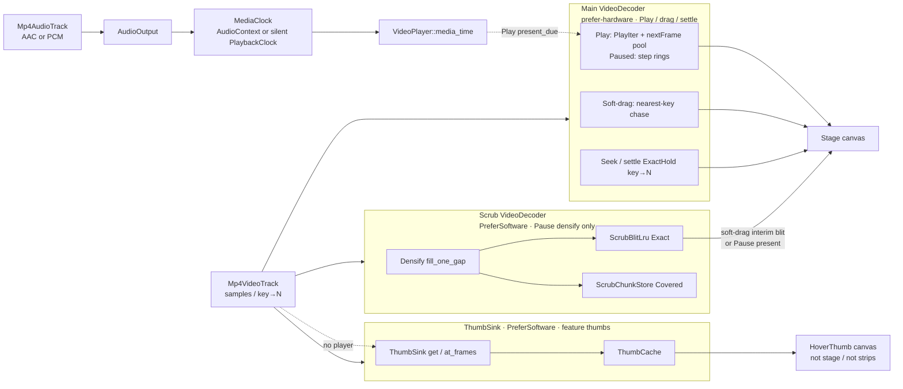
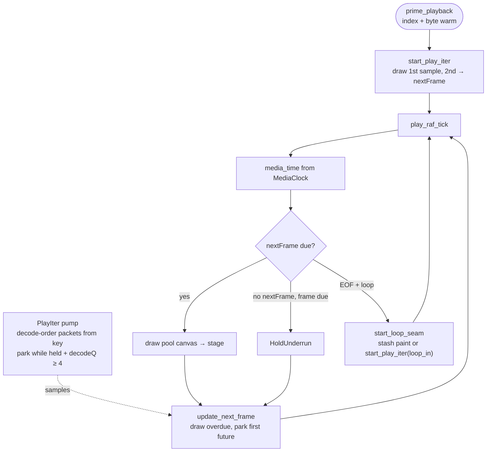
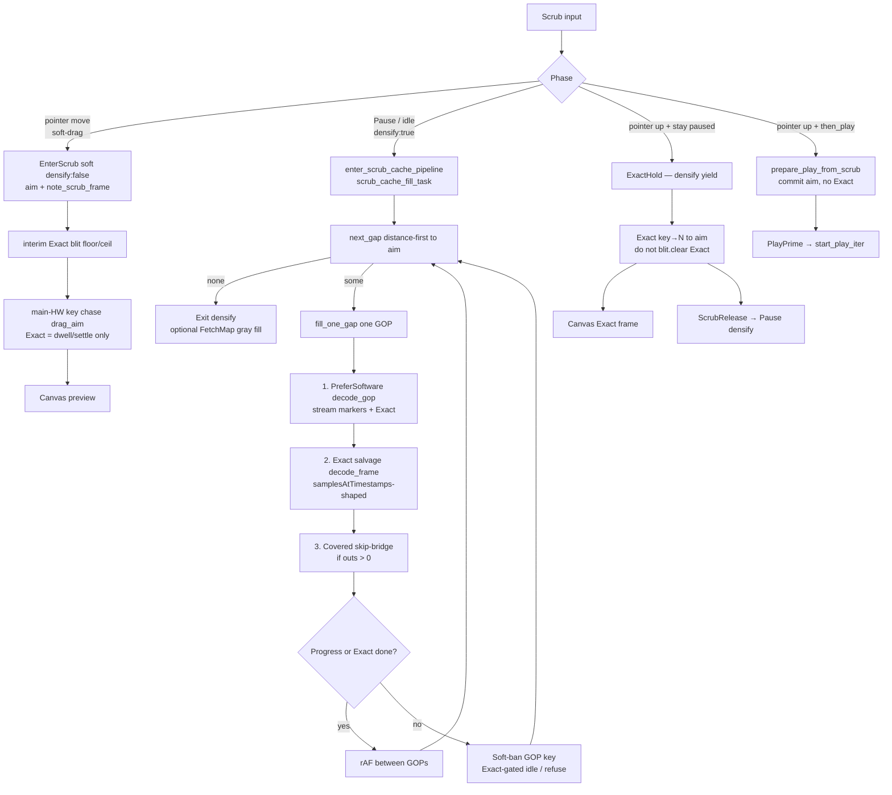
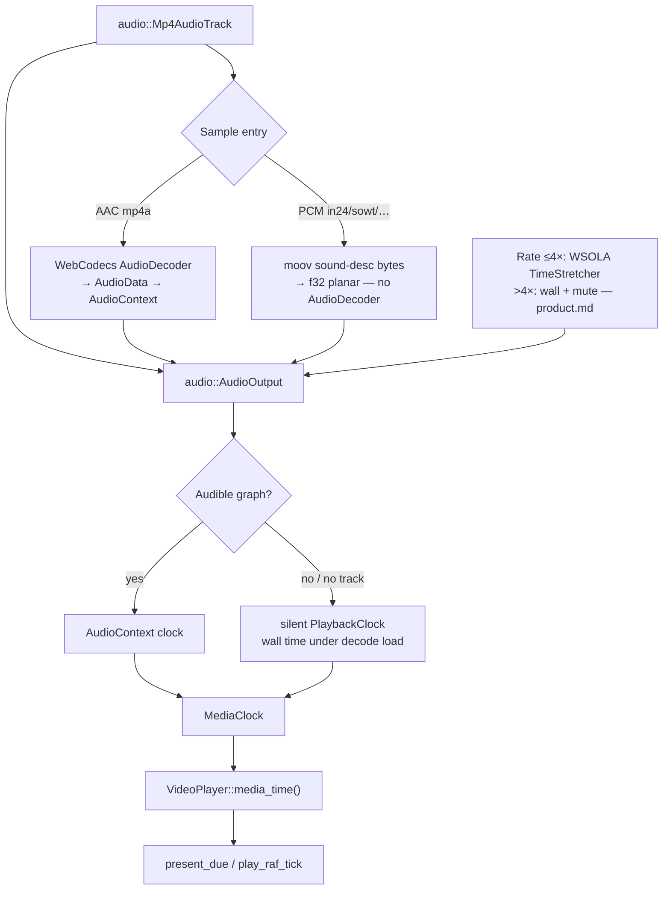

# Architecture

> Stable stack and code-structure context. Read at start of every session.
> Change only after a technical decision proves itself across sessions.
> Backlog / Still open → `.ai/state.md` only (`AGENTS.md` doc write gate).
> Shared vocabulary (settle, densify, Exact, Covered, …) → `.ai/glossary.md`.

---

## Stack

| Piece | Choice |
| ----- | ------ |
| Language | Rust |
| Framework | Leptos CSR — `mount_to_body` SPA |
| Demo host | Trunk (`demo-player/`) — one CSR app for local + Pages; no Axum |
| Local media URL | Same-origin `/media/*` from `demo-player/public/media/` (`npm run media:fetch` ← testvideo v0.3.0) |
| Pages demo | `trunk build --release --public-url /fpmedia-web/` → `demo-player/dist` (`state.md`) |
| Demo UI | `demo-player` — **all** player chrome (controls, scrubber composition, thumb labels). Product boundary: `product.md` § Surfaces |
| Media element | `fpmedia-web-components` — `<Video>` / `VideoRef` + `MediaRef` + `TimelineRef` + `<VideoPlaylist>` + headless `<Scrubber>` / `<TimelineMeta>` / `<HoverThumb>` (`product.md` § Element-layer helpers). Modules: `video`, `media`, `timeline`, `video_playlist`, `scrubber`, `timeline_meta`, `hover_thumb`, `strip`, `helpers` |
| Media engine | `fpmedia-web` crate — demux + frame index + `VideoPlayer`; wasm WebCodecs in `decode/`; **`audio/`** for demux/stretch/output |
| Browser helpers (UI) | **`leptos-use`** for observers / DOM events / rAF — prefer over raw `web-sys` in `components/` / `demo-player/` |
| Styling | Tailwind in `demo-player/style/input.css` (Trunk `rel="tailwind-css"`, auto-download CLI). Prefer **canonical** utilities (`min-w-11`, `min-h-5`, …) over arbitrary `[…]` values when a scale class exists; reuse combos via `@utility` + `@apply`. Arbitrary OK only when no scale fit (e.g. `text-[11px]`, `max-w-[min(18rem,42vw)]`, complex shadows). |

### Leptos UI rules

Long-lived host UI lives **outside** matched routes when routes are added. **Resources:** `resource.get()` in view closures is fine in CSR; show loading UI while `None`. Failure modes: `skills/leptos.md`.

**Browser APIs in `components/` / `demo-player/`:** prefer [`leptos-use`](https://leptos-use.rs/) over hand-rolled `web-sys` + `Closure`. Keep raw `web-sys` for media surfaces (`HtmlCanvasElement`, `Performance`, File) and anything the engine crate owns (WebCodecs / `AudioContext`). Media clock is owned by `fpmedia-web` — hosts call `VideoPlayer::media_time()`, they do not open `AudioContext` themselves.

---

## Layout

```
fpmedia-web/               ← GitHub repo
├── engine/                ← package `fpmedia-web`
├── components/            ← package `fpmedia-web-components`
├── timecode/              ← package `fpmedia-timecode`
├── demo-player/           ← Trunk CSR demo (UI + style + public fixtures)
├── e2e/                   ← Playwright Chromium smoke (WebCodecs)
└── .ai/                   ← product / architecture / state / skills
```

Engine module map (file triage): `.ai/skills/media.md`.

**Versions:** one source until crates.io — root `[workspace.package] version`; publishable members `version.workspace = true`. Path deps omit `version =` while `publish = false` (Cargo cannot inherit `version.workspace` on deps). Demo shows [`fpmedia_web_components::VERSION`](../components/src/lib.rs). Bump only the workspace version for a milestone. At crates.io publish: restore matching `version` on path deps. Backlog: `state.md`.

### Layer rules

| Layer | Can import from |
| ----- | --------------- |
| `timecode/` (`fpmedia-timecode`) | nothing else in the workspace (leaf math) |
| `engine/` (`fpmedia-web`) | `fpmedia-timecode`; nothing in `components` / `demo-player` / Leptos framework |
| `components/` (`fpmedia-web-components`) | `fpmedia-web` (with `webcodecs`), Leptos, `leptos-use` |
| `demo-player/` | `fpmedia-web-components`, Leptos — not `fpmedia-web` directly |

---

## Architectural decisions

| Decision | Why |
| -------- | --- |
| Rust + Leptos CSR (Trunk demo) | One language for engine + UI; demo has no Axum/SSR |
| CSR SPA | Simple mental model; static shell + WASM mount |
| Isolated `fpmedia-web` crate | Engine reusable without UI; no Leptos in demux/decode |
| Isolated `fpmedia-web-components` crate | HTML `<video>` analog + headless track helpers; **no** player chrome (`product.md` Elements first) |
| WebCodecs + canvas | Frame-precise decode; stage mirrors sized `<video>` (contain + metadata) |
| `leptos-use` for browser helpers | Observers/events/rAF in UI crates; media crate stays free of Leptos |
| Adapt mediabunny ideas in Rust | Required reference; port patterns, never depend on the TS package (`AGENTS.md`). MB = sinks + examples; our `<Scrubber>` / `<TimelineMeta>` / `<HoverThumb>` are Leptos adapters over `VideoPlayer`, not MB UI ports |
| Progressive open via `MediaSource` | Ranged reads; parse `moov` (+ `moof` for single-file fMP4); keep `re_mp4` for sample tables. Do **not** `array_buffer()` the whole file into WASM. |
| Dual decoder + scrub / play caches | Dual `VideoDecoder`: main HW for Play/drag/settle; PreferSoftware scrub slot for Pause densify only. Design: [Play / scrub residency](#play--scrub-residency). Traps: `skills/media.md`. |
| ThumbSink + optional hover (`thumbs`) | **Shipped:** `ThumbSink` = mediabunny-shaped `CanvasSink` product (`get` / `at_frames`, `FrameId`, sized `ImageBitmap` + `ThumbCache`). Usable without `VideoPlayer`. Feature default on; runtime `ThumbPolicy`; player leases one PreferSoftware decoder. Host hover: `<HoverThumb>` (`product.md`). Not a TS API clone — see [Decode flows](#decode-flows) |
| Audio in engine, not `VideoRef` | Demux + `AudioDecoder` + `AudioContext` + WSOLA in `fpmedia_web::audio`. `VideoPlayer` orchestrates A+V; `VideoRef` = volume/mute API. `audio/` has no canvas dependency. |
| Component API like HTML media | Elements: open/play/seek/rate/volume + `<Scrubber>` / `<TimelineMeta>` / `<HoverThumb>`. Strip math: `fpmedia_web_components::strip` (engine keeps only `coalesce_frame_runs`). Demo owns chrome + JKL/Space/arrows. Host scrub UI must not require reading `PipelineStats` |
| Domain schedulers, not one global async OS | Byte IO → **shipped** `ReadOrchestrator` + open-ended `UrlSource` workers. Host ops → `OpQueue`. Decode → dual decoder + Play/Scrub modes. Shared **`WorkloadMode`** knobs — **not** one priority queue for every `spawn_local`. |
| Prefer explicit state machines over flag soup | Enum + `reduce` / coalesce table per domain. See [State machines over flags](#state-machines-over-flags). Host: `fpmedia_web::transport` + `ScrubRelease { then_play }` + `VideoRef::scrub_pointer_*`. |
| Playlist = 2× `<Video>` composition (agreed) | Review playlist without N decoders / NLE in engine. See [Playlist composition](#playlist-composition-agreed). UX: `product.md`. Open work: `state.md`. |
| Virtual Timeline policy over Single + Playlist | One Exact/scrub/thumbs/LoopZone-wall axis (Host wrap exec = playlist `loop_seam_exec`; Engine = live `LoopSeam`); backends decode-only. See [Virtual Timeline](#virtual-timeline-agreed). |

---

## Virtual Timeline (agreed)

**no equivalent** (scrub / composition local — not a mediabunny port). Goal: Exact at a playlist cut behaves like Exact mid-clip because **both** go through one policy layer on a global FrameId axis. Single `<Video>` and `<VideoPlaylist>` share that layer; backends only differ.

```text
Host chrome / demo
        → MediaRef (transport: play/pause/seek/goto/step/loop/gain)
        → TimelineRef (scrub/hover/strip; MediaRef::as_timeline)
        → virtual_timeline (Exact settle / resolve / thumb progressive; LoopZone wall + SeamPhase FSM; Host wrap = playlist loop_seam_exec)
        → backend adapters (Single VideoRef | Playlist 2-slot pool)
        → VideoPlayer ×1 or ×2 (demux / decode / clock)
```

| Piece | Rule |
| ----- | ---- |
| Transport facade | **Shipped:** [`MediaRef`](../components/src/media.rs) — shared play/pause/seek/goto/step/loop/gain over Video \| Playlist. Open, `[i]`/`PlaylistPos`, slot/engine knobs stay on concrete refs |
| Policy home | `components/src/virtual_timeline/` — settle law + resolve + [`plan_next_thumb_fill`](../components/src/virtual_timeline/thumb_plan.rs) + [`loop_zone`](../components/src/virtual_timeline/loop_zone.rs) wall geometry (`play_outside_zone` / `plan_scrub_up` / `plan_host_outside`). Covered/Fetch/thumb markers = [`ExactLedger`](../components/src/virtual_timeline/ledger.rs); thumb **bitmaps** = [`VtThumbCache`](../components/src/virtual_timeline/thumb_cache.rs) + 1 [`ThumbProducer`](../components/src/virtual_timeline/thumb_producer.rs). Seam latch / wrap exec still playlist host |
| UI binding | **Shipped:** [`TimelineRef`](../components/src/timeline.rs) — scrub/hover/strip domain. **Covered** + **Fetch** = VT ledger; **Exact** = remapped slot blit (+ idle Exact) |
| Backend | Decode/open/present + densify Exact/Covered in slot; host mirrors Covered → `note_covered(global)`. Single = identity; Playlist = Σ map + 2-slot |
| Exact residency | **Slot `ScrubBlitLru` only** (one store per slot; playlist ≤2× VRAM wallets). PresentHit = `has_scrub_exact_blit`. No bitmap ledger write. Anti-pattern: SoftPark; dual Exact *stores as truth* |
| Covered residency | **Sole on VT** (uncapped global markers). Densify gap-pick stays on slot `ScrubChunkStore`. Wipe VT Covered on close·open / user Scrub Off — **not** idle park/rebind |
| Fetch residency | **Sole on VT** (interval-merged global playable runs). Slot FetchMap = byte authority; host mirrors live+idle → `note_fetch_run`. Wipe on close·open / media replace — **not** idle park, **not** Scrub Off |
| Thumb progressive | **Shipped (playlist):** VT [`VtThumbCache`](../components/src/virtual_timeline/thumb_cache.rs) bitmaps (global FrameId) + **one** PreferSoftware [`ThumbProducer`](../components/src/virtual_timeline/thumb_producer.rs) (`open_mp4` track — **never** `ensure_clip_on_idle`). `plan_next_thumb_fill` may target any clip; ready = VT cache hit. On-slot fill may reuse slot sink then clone→VT. Play: cache/Exact bridge only (no producer). Hover must not steal play idle. **Max decode box** = host `set_thumb_max_size` (default 160²); **residency count** = `thumb_cache_frame_budget` @ 128 MiB (not fixed 256). Single: engine-local `ThumbSink`. **no equivalent** (filmstrip local). Decode: `mediabunny:` CanvasSink |
| Densify path | Engine `next_gap` on live (slot-local pick only; no VT-driven gap queue). Idle **park** (densify off, keep Exact). Off wipe = media replace / user Scrub Off (slot + VT Covered). Exact strip remaps live (+ idle Exact) |
| Exact VRAM | One `blit_mib` (512) for Short/Long; frame count from canvas. All-Intra densify off |
| Thumb ImageBitmap cap | Separate wallet `DEFAULT_THUMB_CACHE_MIB` (128); count = `thumb_cache_frame_budget(max_w,max_h)` (RGBA÷MiB, clamp 32…2048). Not Exact `blit_mib`. Host `set_thumb_max_size` recomputes. **no equivalent** |
| Cut join Exact | **Shipped:** Pause one-shot Exact@join on idle (`prepare_seam_at` densify-free → park keep Exact) so Up PresentHit is common; kick-once per `(idle, join)` — not Move thrash / not soft-drag / not Play SeamHold. LoopZone uses SeamHold/`LoopPlayWarm` (not this). |
| Play · LoopZone on VT | **Shipped:** wall + scrub-Up/Play-outside + wrap-done / seam-next / EOF / Play@clip-last + pure `SeamPhase` FSM + `zone_owner_from_spans` in [`loop_zone`](../components/src/virtual_timeline/loop_zone.rs); playlist `loop_seam` = signal I/O; Host wrap/promote/EOF = [`loop_seam_exec`](../components/src/video_playlist/loop_seam_exec.rs) (`start_host_wrap`). Engine owner = live `LoopSeam`. Next/Prev step stays playlist (`PlaylistPos`). **Later:** CutWindow |
| Readout | `[i]` stays clip-local (`product.md`); scrub/Exact/thumbs/play/loop axis = global |

## Playlist composition (agreed)

**no equivalent** (playlist / dual-slot composition local). Per-clip open/play/EOF still mediabunny-shaped inside each `VideoPlayer`. VT axis + Exact settle: [Virtual Timeline](#virtual-timeline-agreed).

| Piece | Rule |
| ----- | ---- |
| Slots | Exactly **2** `<Video>`: **live** (play / aim / Pause densify, policy On) + **idle** (preload neighbor; **park** densify off / keep Exact). Off wipe = media replace or user Scrub Off — not demote. Exact = slot blit; Covered + Fetch = VT; thumbs = VT wallet (see Thumb progressive) |
| Timeline axis | Global scrub = **Σ presentation frames**. Map `GlobalFrame → (clip_index, ClipFrame)` via clip frame offsets (axes: § Ownership & types). Mixed fps = native rate per clip (no conform); bar cell = `width / Σ frames` |
| Shared scrub handle | **Shipped:** `TimelineRef` — scrub/hover for `<Scrubber>` / `<HoverThumb>` (`VideoRef` / `VideoPlaylistRef` `as_timeline`). Units = frames (playlist = global frame). `VideoPlayer` / `<Video>` stay single-clip |
| Playlist model + host | **Shipped:** `video_playlist` — model/`[i]`; `<VideoPlaylist>` / `VideoPlaylistRef` (2 slots, probe, play seam, seek/scrub/step rebind, frame-domain `TimelineRef`) |
| Demo open | **Shipped:** multi-file picker + `;`-separated URLs → playlist; 1 source → `<Video>`; `[i]` position/go-to. Host CSS hides `.fpvideo-playlist-slot.is-idle` |
| Strip / tip domain | One owner: `TimelineRef` (playlist units = **global frames**). Gesture / tip / hover / zebra / `<TimelineMeta>` all use it. `strip_video()` → live slot for Keyframes/Ready interest; Fetch also leases idle. **Fetch** + **Covered** = VT (`strip_fetch_marks` / `strip_covered_marks`); Exact via `strip_ready_marks`. Meta re-leases on `strip_video_key` change — **never** remount `<Scrubber>` on live swap. Mirror live→`playhead`/`pos` when not `scrubbing` (Play + paused step/seek; scrub gesture owns aim) |
| Facade | Host sees one logical media (play/pause/seek/scrub/rate/step + **shared volume/mute/rate** + **`playing` intent**). Cross-clip: promote idle when ready, else settle/`seek_pos` opens + swaps. `VideoPlayer` unchanged (single-clip) |
| Seam | **`LoopOwner`** (= VT `ZoneOwner`): zone ⊆ live → `Engine` (`sync_live_loop_from_playlist` → `LoopSeam`); else `Host` → [`loop_seam_exec`](../components/src/video_playlist/loop_seam_exec.rs) `promote_idle_at` / `wrap_to_loop_in` / `start_host_wrap`. Owner law = VT `zone_owner_from_spans`; latch = VT **`SeamPhase`** via playlist signal I/O. Densify-free seam paint via `seek_frame_with(..., false)`. Playlist `playing` stays true across slot `pause_hard` / EOF until pause, terminal end, or seam error — do not mirror live `VideoRef::playing` for chrome. |
| Host promote policy | **`PromoteLead`** (`Origin` @0 / `Mid` @`loop_in`): idle **main** `SeamHold` before wall; promote → PlayPrime **release**. `seek_to_pos(then_play)`: Play → SeamHold; pause/goto → slot Exact PresentHit or `prepare_seam_at` + `seek_frame` — never leave SeamHold densify-blocked. Single/Engine loop: **2nd HW** `LoopPlayWarm` (SW stash fallback). Port map: [below](#loopseam-vs-host-promote). |
| Host prewarm schedule | **`seam_warm_schedule`**: `LoopOwner` + zone + media time → `SeamWarmTarget` (`PromoteLead` + idle). Kick → `kick_arm_seam_hold` when `SeamPhase::Idle` and owner ≠ `Engine`. Priority: Host zone wall → near clip-EOF next/`loop_in`. |
| Shared scrub / thumbs | One scrub gesture over playlist model. Thumbs: **VT bitmap wallet** + 1 producer (slots stay Play/scrub; may Exact-bridge / on-slot decode into VT). Pause progressive = VT plan across Σ (`video_playlist::thumbs`). Hover: VT cache first; off-slot Pause → producer (not idle ensure). See [Virtual Timeline](#virtual-timeline-agreed) Thumb progressive |
| Idle neighbor | Play / seam: next clip; on last + playlist **loop** → **0**; else previous (`idle_neighbor` / `set_loop` re-preload). **Scrub:** `PlaylistModel::idle_neighbor_near_cut` — idle = other clip of the **nearest cut** (near 1\|2 → slots 1+2; near 2\|3 → 2+3), mid-clip hysteresis. Not scrub-dir; not cut-warm v1 playhead×margin thrash. **Pause Exact@join:** `cut_join_local` + `kick_cut_join_exact_warm` (see Cut join Exact above) |
| Compare (later) | Same 2-slot pool, both visible — not the playlist playhead model |

### Playlist host plans (slices A–F)

**no equivalent** (playlist local). Pure `plan_*` in `video_playlist::plan`; UI runs cmds (`run_scrub_up_plan`, `start_host_wrap`, `run_wrap_done`, `run_step_plan`, `advance_after_ended`).

| Event | Condition | Plan (cmds) |
| ----- | --------- | ----------- |
| Scrub Up resume + Host outside | VT `play_outside_zone` / `plan_scrub_up` | preempt scrub → `start_host_wrap` (no Exact@outside) |
| Scrub Up else | on live / cross-clip | `LiveSettle` / `CrossClipSeek` (± then_play) |
| PlayPressed outside | VT `plan_host_outside` (past-out **without** wall-on-live gate) | Host → `start_host_wrap`; Engine → slot `play`; else clip-EOF / bare play |
| Wall Effect outside while Playing | same VT plan with `past_out_needs_wall_on_live` | HostWrap only when `zone_last` on live; else EOF advance owns join |
| WrapDone / seam Err | VT `plan_wrap_done` (`is_soft_seam_cancel`) | soft → `ResumeLiveKeepPlay`; hard → clear Play + error; epoch mismatch → Ignore |
| Next / Prev | playlist `plan_step` (no LoopZone) | mid → `LiveStep` + clear intent; edge → `GotoPos` (`goto_pos`); terminal → `ClearPlayIntent` |
| Clip EOF advance | VT `plan_advance_ended` + `plan_seam_next_clip` | Wrap / Promote@0 / TerminalEnd; Effect still latches `try_begin_seam` before clear `ended` |
| Play@clip-last (Host, inside zone) | VT `plan_play_at_clip_last` + `plan_seam_next_clip` | PromoteSeek@0 / HostWrap (mid-in parity with EOF) |

Soft cancel ≠ sticky UI error. User goto stays on ref (`goto_*` → `stop_play_for_goto` + seek). Internal `seek_*` does not stop Play. Traps: `skills/leptos.md`.

---

## State machines over flags

Event-loop races (pointer → microtask → `OpQueue` → rAF) are **not** fixed by more `RwSignal<bool>` or TLS. Rust `Send`/`Sync` also does not order JS turns.

**Prefer:** one state enum per domain + sync `reduce(Event) -> (State, Cmds)`; illegal combos unrepresentable; coalesce in the scheduler; call sites only dispatch / run cmds.

**Avoid:** sticky latches in demo + component + TLS; Effects that clear intent “when playing flips”; half-ported machines.

| Domain | Machine |
| ------ | ------- |
| Host transport | `fpmedia_web::transport` + `ScrubRelease { then_play }` + `VideoRef::scrub_pointer_*`. `ui_playing` = play intent (incl. scrub-while-play) — `product.md` § Play chrome. |
| OpQueue | `fpmedia_web::HostOp` / `apply_enqueue` (in place); epochs preserved on survivors |
| Engine mode | `fpmedia_web::engine_mode` (`Play` / `Scrub` / `ExactHold` + `AudioResume`). Densify abort via cmds: `EnterScrub` / `PreExact { rearm }` / `BeginExact` (always AbortDensify rearm true) / `ScrubCacheOff` / `EnterPlay`. Seek/settle: **`PreExact` → densify yield → `BeginExact`**. Seam densify=false only on PreExact. Not `pause_inner` side-door `abort_scrub_fill`. |
| Decoder slot | `fpmedia_web::decoder_slot` (`Idle` / `CheckedOut` + `reset_pending`) |
| WorkloadMode | `fpmedia_web::workload` (Play > Seek > Open > Bg) |
| Byte IO | `ReadOrchestrator` + `UrlSource` / `BlobSource` stream workers |
| Open / backfill | `fpmedia_web::open_phase` (`OpenPhase::label`) |
| Media clock | `fpmedia_web::clock_state` |
| Play session | `fpmedia_web::PlayPhase` (`Idle` / `Live` / `LoopSeam`) |
| rAF restart | `fpmedia_web::session` (`restarting`) |
| Playlist host | `LoopOwner` + `SeamPhase` (VT reduce + playlist signals) + facade `playing` + **`plan_*` in `video_playlist::plan`**. Derive owner via `zone_owner_from_spans`; never probe slot `Video.looping` / slot `playing` for chrome. Table: [Playlist host plans](#playlist-host-plans-slices-af) |

**Success bar:** a new race is fixed by a transition or coalesce row, not another flag. Failure modes: skills.

---

## Progressive open (MediaSource)

**Shipped (wasm demo):** `MediaSource` + `BlobSource` / `UrlSource` on `ReadOrchestrator` (Url: open-ended Range workers, `Network` prefetch; Blob: 4 `blob.stream()` workers, `FileSystem` ±64 KiB prefetch, 8 MiB — `arrayBuffer()` per read only on WebKit; `mediabunny: src/source.ts`) / `MemorySource` + `CachedSource` (512 MiB LRU, 8 MiB quantum; orch cache mediabunny-default 64 MiB); gray strip = **playable** spans on **VT** (slot `FetchMap` → `playable_frame_runs` → host `note_fetch_run`; URL accumulate on download; Blob seed + prefetch `note_local_gray` only — not per-sample; per-window presentation span + soft-merge paint). Top-level `ftyp`+`moov` (+ full `moof` for single-file fMP4) → `re_mp4`. Element `open_blob` / `open_url` (CORS-ok or same-origin URL — **no** auto `/proxy` in `fpmedia-web-components`). Async AVC sync verify after moov. One progressive entry `open_mp4(source, options, progress)` → `OpenedMp4` (always `CachedSource`; `mediabunny: src/input.ts Input`); sync `open_mp4_bytes` for fixtures/tests.

**Demo URL open:** one UI everywhere. Progressive local URL = static `/media/*` under `demo-player/public/media/` (fetch script; gitignored). Demo may rewrite known testvideo Release download URLs to `/media/…`. No CORS/media proxy (Trunk→GitHub redirect broken). Pages: Browse (Blob) or CORS-ok URLs. Element crate never rewrites (`components/README.md`).

**Out of scope:** stream-only / live fMP4; DASH/HLS; MSE remux; production open proxy. **Open work:** `.ai/state.md`.

**Success bar:** 1080p progressive open to first paint without allocating the full media size in WASM.

### Test media

| Kind | Where |
| ---- | ----- |
| Tiny unit/smoke MP4s | `fixture_*.mp4` under `engine/tests/fixtures/` + `demo-player/public/` (gitignore allows that prefix only) |
| FullHD A/V sync plates | **[testvideo](https://github.com/alexantoshuk/testvideo)** Releases — catalog `e2e/helpers/testvideo.ts` |

Do **not** wire probes to Downloads / third-party hosts. In skills prefer meta (fps, GOP, resolution, bf); asset names = testvideo stems.

---

## Play / scrub residency

Dual `VideoDecoder`: **main** = Play / seek / soft-drag / settle Exact (`prefer-hardware`, incl. mobile); **scrub slot** = Pause densify only (`prefer-software` — must not dual-HW poison main). Soft-drag never runs densify under the finger (mobile SW densify was too slow). UX strip colors: `product.md`. Vocabulary: `glossary.md`.

| Store | Role |
| ----- | ---- |
| `PlayIter` + 2-canvas pool | Play only: ≤ 4 decoded + in-flight samples, one `nextFrame` canvas |
| Presentation queue | Paused Next hits (`PlayPolicy::presentation_cap`); empty while Playing |
| Step behind ring | Prev hits; **Play cap 0**; Pause/scrub uses behind=8 |
| `ScrubChunkStore` | Covered gap markers — **presence only, uncapped** for the open clip |
| `ScrubBlitLru` | Live Exact bitmaps; cap from `scrub_blit_frame_budget` |
| `ThumbSink` / `ThumbCache` | Thumb product + hover client (3rd decoder); feature `thumbs` |

Runtime gates (host intent, re-applied on every open): `ThumbPolicy` (thumb sink) and **`ScrubCachePolicy`** — **capability** only: `Off` closes the scrub decoder, clears Covered + Exact, refuses densify / gray fill / scrub ingest; `On` allows those paths but does **not** start densify (arm via `EnterScrub{densify}` / pause / settle / `seek_frame`; seam uses `seek_frame_with(..., false)`). Playlist idle demote uses **`park_scrub_cache`** (AbortDensify + drop decoder, **keep** Exact) — not Off wipe. Seek/step/Play stay on main. Demo: Scrubber toggle → `ScrubCachePolicy`.

**Modes (summary):** Play → densify off (epoch cancel). Hard Pause / settle / step → densify on when `ScrubPolicy::densify` (PreferSoftware scrub slot). Soft-drag → densify off under finger + interim Exact blit + **main-HW** nearest-key chase (Exact = dwell/settle on main after densify yield). One entry: `VideoPlayer::enter_scrub_cache_pipeline`. In-flight GOP densify is not cancelled on aim move (drag aborts fill for the gesture). Covered keeps densify/Exact trail for the clip (no marker LRU); Exact eviction = farthest from aim on blit `AimWindow` only. Pause densify fills Exact first; Covered-only densify is hard-bounded to aim±`COVERED_EDGE_MARGIN_FRAMES` (300; store stays uncapped for the trail; pinholes must not walk EOF). Not Exact cap / not GOP soft-drag margins. `mediabunny:` CanvasSink pool idea — no still-encode store.

### Decode flows

Shipped control flow (not backlog). Terms: `glossary.md`. Phase × mode table: [Scrub phases](#scrub-phases) below. Failure modes: `skills/media.md`.

**Overview — who decodes what**



Play paints `PlayIter` samples from the **main** decoder (checked out for the whole session), paced by **`media_time()`** from the engine media clock (audio-driven when a track exists — including muted/silent graphs; see [Audio + media clock](#audio--media-clock)). Soft-drag / cold scrub / settle Exact: **main HW** (densify aborted / yielded — PreferSoftware under the finger was too slow on mobile Chrome). Pause idle densify fills Exact + Covered on the **scrub** PreferSoftware slot. Hosts never open `AudioContext` as their own clock.

**ThumbSink** (optional `thumbs`): mediabunny `CanvasSink`-shaped product — `ThumbSink::new(track, opts)` → `get` / `at_frames` / sync peek; sized `ImageBitmap` + `ThumbCache` residency (not MB ring `poolSize`; cap = `thumb_cache_frame_budget` @ `DEFAULT_THUMB_CACHE_MIB`). **Does not require** `VideoPlayer`. Hover is a client: player leases one PreferSoftware decoder, Exact→thumb bridge, workload gates; host `<HoverThumb>` paints its **own** canvas. UX: Play and Pause only — **not** while scrubbing; must not drive densify or Fetch/Covered/Exact strips (`product.md`). Never reuse the densify scrub decoder for thumbs. Play: cache + Exact bridge only (no generation). Pause progressive: duration-based coarse sync grid (~3 s, clamp 8–32, ≤`max_thumbs/4`) then farthest-key densify; each thumb stores progressive **rank** (0=coarse … Exact non-key=`u16::MAX`); at cap evict highest rank first so the timeline grid stays even. Hover uses the same rank helper. Progressive stops when no candidate can admit without dropping a coarser rank. Host `(hover: none)` → `ThumbPolicy::Off`. **no equivalent** (filmstrip local); decode `mediabunny: src/media-sink.ts CanvasSink` / `canvasesAtTimestamps`. Traps: `skills/media.md`.

**Play — mediabunny iterator port** (`mediabunny: src/media-sink.ts mediaSamplesInRange`, `examples/media-player` `startVideoIterator` / `updateNextFrame` / `render`)



`PlayPhase` (`Idle` / `Live` / `LoopSeam`) is the session machine; seek / scrub / pause end it (`clear_play_session` → `PlayIter::finish` resets and returns the decoder). Seek / step / Exact stay on `decode_frame` + warm pump (`samplesAtTimestamps`-shaped); Play never reads the presentation queue.

**Loop (local / Remotion-shaped):** MB media-player has no loop. Near zone-end (~1 s) warms **loop-in** bytes + **2nd HW** `LoopPlayWarm` (PlayIter @`loop_in`, dual-HW ~1 s) while main still Plays; PreferSoftware stash = fallback. `LoopSeam` **adopts** the warm iterator (no cold catch-up) or paints SW stash + bg catch-up / cold `start_play_iter`. Traps: `skills/media.md`.

**LoopZone (shipped, local):** Half-open `[in, out)` while `looping`. Default = full axis (`in=0`, `out=frame_count` / Σ frames). Vocab: `glossary.md` § LoopZone. UX: `product.md` § Loop zone.

| Surface | Rule |
| ------- | ---- |
| Single `<Video>` | Source FrameIds; engine EOF wall at zone end; `LoopSeam` → `loop_in`. API: `set_loop_zone` / `loop_zone`. |
| Playlist | Global frames. **`LoopOwner::Engine`** (zone ⊆ live, incl. full-axis one file) → Video `LoopSeam`. **`LoopOwner::Host`** → `promote_idle_at` / `wrap_to_loop_in` under **`SeamPhase`**. Owner = VT `zone_owner_from_spans` — do not read slot `Video.looping`. |
| Navigation | **Goto** / Next / Prev / paused scrub **ignore** the zone (full axis; goto/step stop Play). Scrub-while-play resume = Play (outside → `loop_in`). LoopZone only Play + wall wrap. Vocab: `glossary.md` § Goto vs Seek. |
| Full axis | Same as pre-zone last→0 / last-clip→0 seam. |
| Demo | `[` / `]` set in/out from playhead (same spot toggles reset in→0 / out→full), arm loop if off; scrubber dim outside zone. |
| Later | CutWindow (`state.md`). |

##### LoopSeam vs host promote

Shared warm/stash primitives on `VideoPlayer`; host owns **slot swap only** (no second engine `LoopSeam` FSM). Host entry = [`loop_seam_exec`](../components/src/video_playlist/loop_seam_exec.rs) (`start_host_wrap` / `advance_after_ended`). **no equivalent** (playlist local).

| Step | Single `<Video>` `LoopSeam` | Playlist Host promote |
| ---- | --------------------------- | --------------------- |
| Near-wall warm | `maybe_kick_loop_origin` → bytes + **2nd HW** `LoopPlayWarm` @`loop_in` (SW stash fallback) | `seam_warm_schedule` → `PromoteLead::kick_warm` → idle **main** `SeamHold`; skip when `LoopOwner::Engine` |
| Play-ready / paint | `adopt_loop_play_warm` (or SW stash + bg catch-up / cold `start_play_iter`) | Idle `arm_playlist_seam_hold_at` → PlayIter under hold; paint prepare = fallback |
| Session / clock | Hold → resume **same** `VideoPlayer` (warm HW becomes Play) | Outgoing `pause_hard_no_densify` → swap → PlayPrime **release**: Host mid-zone (`!zone_full`) restarts PlayIter @aim (prepare-only refresh re-snaps); full-axis keeps hold iter. Both: `hard_reset_timeline_to(aim)` + `seam_release_aim` (`Some` = no-skip) until `frame > aim` (one snap; not per-rAF); no catch-up grace; overdue ≤1/kick |
| Slot | Same stage | `swap_live_idle` then release / cold Play |
| Module | engine `play.rs` `start_loop_seam` | playlist `loop_seam_exec` (+ `slots` warm/swap) |

While Playing: densify is off (epoch cancel); Exact trail uses farthest-evict trim only — never a full Exact wipe. Continuous Play prioritizes cadence and A/V sync over painting every presentation frame (`product.md` Exact vs Play). Shuttle may drop overdue frames. Prefer mediabunny present + clock patterns; silent clock uses wall time when there is no audible audio graph.

**Scrub — soft-drag / Pause densify / settle**

Scrub gesture / densify / Exact blit are **local** — mediabunny has no scrub pipeline (`AGENTS.md` § Scrub is local). Cite MB only for demux/decode/sink primitives inside a scrub change.



Soft-drag must not run densify under the finger (PreferSoftware densify saturates mobile Chrome); picture updates via **main-HW key** chase on `drag_aim` (Exact = dwell/settle on main only — traps: `skills/media.md`). Soft-drag **and** hover-thumb interim paint pick neighbors with **floor when moving forward / ceil when backward** (`scrub_preview_neighbor` + `scrub_dir` / `hover_dir`) within `SCRUB_DIR_BIAS_MAX_LAG_FRAMES` of aim (near-trail settle anti-reverse); beyond that lag, take the closer side so cold Exact/Thumb holes do not stick on a stale previous frame. Hover then merges ThumbCache vs Exact via `hover_preview_choice` (distance; Exact on tie) — not soft-drag `scrub_preview_choice_with_dir` (GOP-key filter). Settle must not wipe Exact blit (soft-drag trail). Densify soft-ban stops infinite re-decode; residual pin-holes on constrained machines are accepted strip cosmetics (`product.md`). Scrub-while-play release skips Exact.

### Scrub phases

Host gesture × engine (FSM homes: `fpmedia_web::transport`, `fpmedia_web::engine_mode`). Exactness = settle / seek / step / Pause canvas — not soft-drag (`product.md` Exact vs Play). Hover thumb: Play + Pause only, not while `Scrubbing` (`product.md`).

| Phase | Host `TransportState` | `EngineMode` | Densify | Picture | Entry |
| ----- | --------------------- | ------------ | ------- | ------- | ----- |
| Play | `Playing` | `Play` | off | `PlayIter` `nextFrame` | play / rAF |
| Soft-drag | `Scrubbing` | `Scrub` (+ soft audio hold) | off under finger | interim Exact blit + main-HW **key** chase (Exact = dwell/settle) | `VideoRef::scrub_pointer_down/move` → `note_scrub_frame` / `scrub_to(settle=false)` |
| Pause / idle scrub | `Ready` (paused) | `Scrub` | on if `ScrubPolicy::densify` | densify → blit + markers | `enter_scrub_cache_pipeline` |
| Settle | `Settling` | `ExactHold` | deferred (yield) | Exact key→N on **main HW** | paused `ScrubRelease` only — **do not** full-clear Exact blit (see `skills/media.md` soft-drag frozen) |
| Resume | `PlayPriming` → `Playing` | → `Play` | off | PlayIter draws aim (no Exact / no audio prewarm) | `ScrubRelease { then_play }` → `prepare_play_from_scrub` → PlayPrime |

Traps: `skills/media.md`. Host playhead / `scrub_pointer_*`: `skills/leptos.md`.

### Predictive densify

Local invention (no mediabunny CanvasSink densify equivalent). Unit of work = one GOP; `next_gap` is **distance-first** to aim (far/edge loses to budget eviction); `scrub_dir` (`ScrubDir::Ahead` / `Behind`) only breaks equal-distance ties. Settle/play clears dir to `Neutral`.

**GOP fill (`fill_one_gap`):** (1) PreferSoftware `decode_gop` range decode → stream markers + Exact blit; (2) Exact salvage — any GOP id still missing blit → scrub `decode_frame` key→N (`mediabunny: samplesAtTimestamps` vs `samples()` range); (3) Covered skip-bridge for marker ids still absent (`outs > 0` only). Soft-ban a GOP key only when Exact cannot improve (blit complete / cap refuse / idle retries) — never because Covered alone looks solid. Traps: `skills/media.md`.

### Policies

**`GopProfile`** (scrub only, from frame index):

| Profile | When | Densify (Pause) | Drag |
| ------- | ---- | ---------------- | ---- |
| `AllIntra` | every sample sync | off | soft + main-HW key (= frame; densify off) |
| `ShortFixed { len }` | max GOP ≤ 30 | on (PreferSoftware) | soft + main-HW key chase (Exact on dwell/settle) |
| `Long { median, max }` | max GOP > 30 | on (PreferSoftware) | soft + main-HW key chase (Exact on dwell/settle) |

**`PlayPolicy`** (from coded height) — paused step ring cap + seek/step warm pump only. **Play reads none of it:** mediabunny `MAX_QUEUE_SIZE = 4` + 2-canvas pool for every resolution (add Play profiles only if a clip proves they are needed).

| Class | Cap / warm |
| ----- | ---------- |
| `Hd` (&lt; 2160) | 4 / 4 |
| `Uhd` (≥ 2160) | 10 / 8 |

**Main** (`WebCodecsDecoder::create` `allow_hw=true`) always probes `prefer-hardware` when supported — Hd and Uhd, **desktop and mobile**. Owns Play, soft-drag key chase, seek/settle Exact. **`PlayPolicy::prefer_hardware`** documents Uhd intent only — it does **not** gate main HW (Hd field may be `false`; create still probes HW).

**Scrub densify / thumb** (`create_scrub` / `create_thumb`): always `PlayPolicy::hd()` knobs + explicit `prefer-software` so densify never dual-HW poisons main (`no-preference` can still grab HW). Soft-drag does **not** use this slot. `optimizeForLatency` = false for VOD.

**`ScrubPolicy`** (from `GopProfile`): `densify` on/off + edge margins; **one** Exact `blit_mib` (512) for Short/Long — frame count from canvas only (`scrub_blit_frame_budget`). All-Intra: `densify` off (soft-drag interim blit still sized). `scrub_cache_mib` = legacy meter; Covered uncapped. Soft-drag: interim blit + main-HW nearest-key chase. Pause densify PreferSoftware when `densify` on.

**`SettlePolicy`** (clip-invariant defaults): densify yield `250+250 ms`, `gop_sample_lead` 8…24, index warm leads (`play_index_lead` also feeds the Play iterator). Soft-cold / poison are named recovery helpers, not policy fields. Do not retune Settle when changing Play Uhd or Scrub MiB.

Traps (flush/idle, cold settle, dual-HW): `skills/media.md`.

### Audio + media clock

Terms: `glossary.md`. Overview link: [Decode flows](#decode-flows).



PCM sample-entry bodies are not in `re_mp4`’s `Unknown` payload — walk raw `moov` (same pattern as `tmcd`). Codec map + decode: mediabunny `isobmff-demuxer` FourCC map + `media-sink.ts` `PcmAudioDecoderWrapper`. Hosts never open `AudioContext` as a disposable clock. Soft-hold on scrub/Pause keeps the graph; underrun holds audio without tearing the decoder down. mediabunny has no rate API equivalent — WSOLA is local. UX rates: `product.md`.

---

## Code rules

- Errors: `thiserror`. A panic kills the whole wasm instance (player + `AudioContext`) until reload, so:
  - No panics on paths reachable from browser events, the environment (`window` / `document`) or external data (file bytes, network) — return `Err` / `let … else`.
  - `.unwrap()` is forbidden outside tests (enforced: workspace Clippy `unwrap_used = "deny"`).
  - `.expect("<invariant>")` only for an invariant proven in the same function, when a `let … else` / entry-API rewrite reads worse.
- WebCodecs needs `web_sys_unstable_apis` (`.cargo/config.toml`).
- **WebCodecs / media resources:** RAII owners + borrow helpers (`OwnedVideoFrame` / `AsVideoFrame`); **move into caches**, **borrow to draw**. Gotchas: `skills/media.md`.
- **Mediabunny reference:** `AGENTS.md` Mediabunny-first — do not restate here.

### Ownership & types

Canonical home for ownership / pointer / primitive-type conventions (agent gate: `AGENTS.md` § Type / ownership check).

- **Single-threaded wasm:** `Rc` / `RefCell` / `Cell`. `Arc` / `Mutex` / `Send + Sync` only for real cross-thread use (Worker) — a fake `Send` bound guarantees nothing.
- **`dyn` only for open sets:** `Closure<dyn FnMut>` (wasm-bindgen), public extension traits (`MediaSource`), composite cancel predicates `&dyn Fn() -> bool`. Closed set → `enum`. Host → component API = methods on the concrete handle, **not** a struct of `Rc<dyn Fn>`.
- **One level of shared ownership:** no `Rc<RefCell<Option<Rc<T>>>>`. A handle = `Clone` over `Rc<Inner>`. `VideoPlayer` is one (`VideoPlayer(Rc<PlayerInner>)`, `Deref` to `PlayerInner`): clip teardown = `Drop for PlayerInner`, i.e. when the **last** clone goes (a clone held by a spawned task delays it); methods that spawn work and must keep the player alive live on the handle (`&self` + `self.clone()`), everything else on `PlayerInner`. Leptos: `StoredValue<T, LocalStorage>` instead of `StoredValue<Rc<RefCell<T>>>` when nothing borrows across `.await`.
- **One frame axis width:** every presentation frame index, frame count and frame-denominated margin / lead is `FrameId` (`u32`, ~4.29 G frames) across engine, `timecode`, components, demo and UI signals — no `u64::from` / `as u32` bridges. Bytes, PTS ticks, epochs and generation ids stay `u64` / `i64`. Use a wider intermediate (`u64::from(x) * …`) only for products; `saturating_*` / `try_from` for sums that could leave `u32`.
- **Value types over primitives:** no bare span tuples — inclusive frame spans are `FrameRun` (one `merge_frame_runs` for FetchMap + VT Fetch ledger), half-open ranges are `LoopZone`; LoopZone normalizes only via engine `LoopZone::normalize`; `enum` instead of `i8` or paired `bool`s.
- **Three frame axes (components):** `FrameId` = **Source** (file frame; engine, `VideoRef`, `VideoHost`, UI signals). `ClipFrame` = position inside a playlist clip (`PlaylistPos.frame`, `BackendAim.frame`, `StepCtx`). `GlobalFrame` = Σ-clip timeline position (`global_frame_at`, `at_global_frame`, `resolve_*`, `ExactLedger` and `VtThumbCache` keys). Mixing axes does not compile. `ClipFrame::source()` / `from_source()` is the **only** Clip↔Source seam — identity today; CutWindow `cut_in` lands there. Bulk key lists for planners (`thumb_plan`, ledger id lists) and `FrameRun` stay raw `FrameId`.
- **Fields that change together → one `Copy` struct** (illegal combos unrepresentable; see [State machines over flags](#state-machines-over-flags)).
- **Release in `Drop`:** decoder, `SingleFlight` busy via guard / lease — not a manual call on every error branch (extends the RAII rule above). `SingleFlight` ([`engine/src/model/bg_task.rs`](../engine/src/model/bg_task.rs)) is a `Clone` handle: `request()` / `try_claim()` → `Option<FlightGuard>` held for the whole task (`Drop` = busy off, pending kept); normal exit = `guard.finish()` (busy off + take pending), re-arm = `begin()`. Out-of-task clear (settle yield gave up, thumb `clear`) = `force_release()`, which retires the live guard so its late `Drop` / `finish` cannot clear a newer owner. A `PlayIter` outside the `play_iter` slot (HW `LoopPlayWarm`, SW loop-origin stash) is held by `PlayIterGuard` (`video_player/play_pool.rs`; `Drop` = `finish()` + decoder to its `IterHome`: close, or scrub slot); the main iterator ends only through `PlayerInner::end_play_iter` (decoder → `decoder_slot`). `mediabunny: src/media-sink.ts mediaSamplesInRange` `finally` / `iterator.return()`.
- **Cancel / stale-work counters = `Epoch` + `Ticket`** ([`engine/src/epoch.rs`](../engine/src/epoch.rs)): async work captures a `Ticket` before an `.await` and checks `epoch.is_current(ticket)` after it; invalidation = `epoch.bump()`. Used for `pump_epoch`, decoder callback `generation`, `ThumbSink` / `ThumbProducer` / audio output, player `op_epoch` / `scrub_epoch`. Host code holds the Leptos `Copy` wrapper `LocalEpoch` (playlist `open_gen`, hover-thumb paint). A ticket is not a frame count or PTS — no bare `u64` epochs. Data-version counters (`Mp4VideoTrack` `sync_gen`) and reactive bump signals (`*_residency_epoch`) are not cancel counters and stay as they are.
- **Park / wake lists = `Waiters`** ([`engine/src/waiters.rs`](../engine/src/waiters.rs)): one `Clone` handle for every Promise-resolver list (WebCodecs output / dequeue / not-empty, audio progress / ahead). `wake_deferred` takes the list and resolves via `spawn_local` — never wake synchronously from a decoder / audio callback. Which callback wakes which list stays at the call site.
- **Same mechanism in ≥2 places → one shared helper** (`product.md` § Share common logic).
