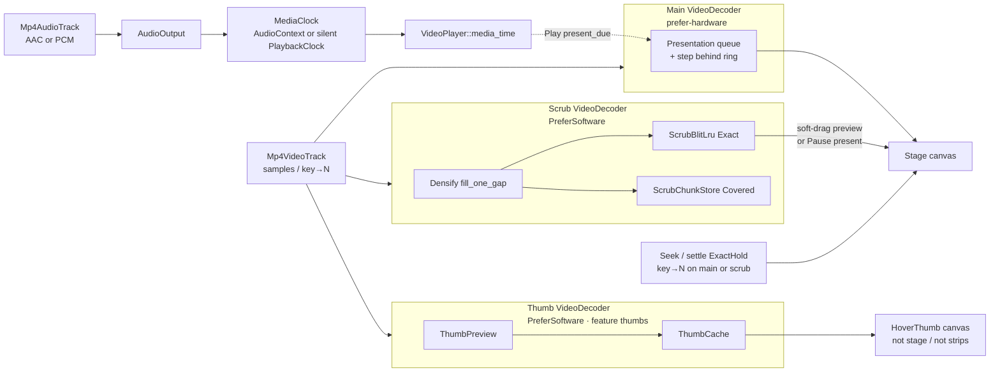
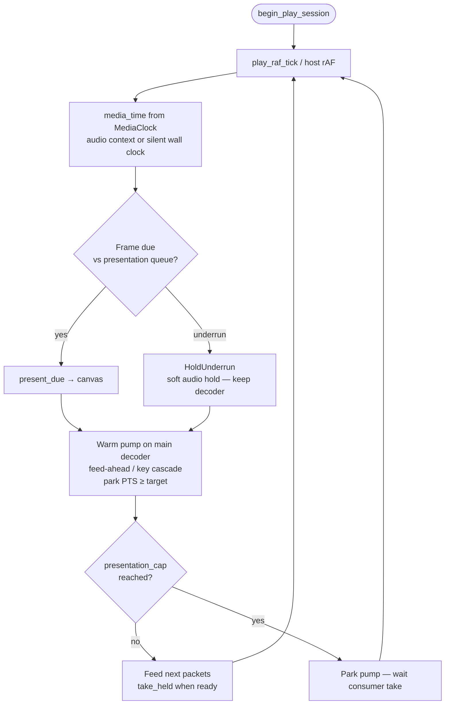
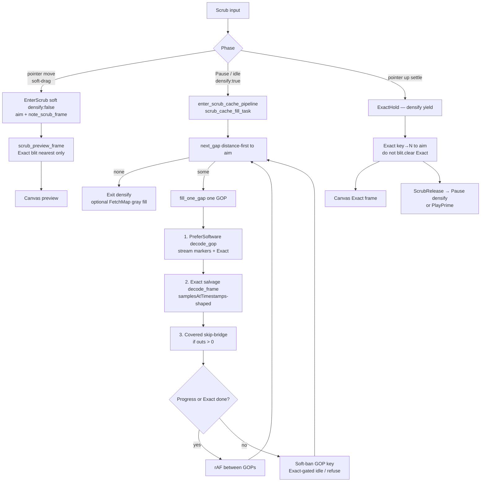
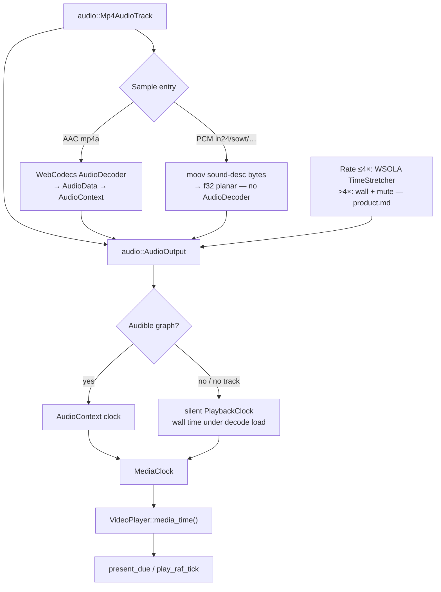

# Architecture

> Stable stack and code-structure context. Read at start of every session.
> Change only after a technical decision proves itself across sessions.
> Backlog / Still open → `.ai/state.md` only (`AGENTS.md` doc write gate).
> Shared vocabulary (settle, densify, Exact, Covered, …) → `.ai/glossary.md`.

---

## Stack

| Piece | Choice |
| ----- | ------ |
| Language | Rust, full-stack |
| Framework | Leptos CSR — `mount_to_body` SPA; static `index.html` shell |
| Server shell | Axum (`server/`) — static files, optional fixture serving |
| Client shell | `frontend/` — `mount_to_body(App)` (export name `hydrate` for cargo-leptos) |
| App UI | `app` crate — **all** player chrome (controls, scrubber composition, thumb labels) + thin SSR shell. Product boundary: `product.md` § Surfaces |
| Media element | `media_components` — `<Video>` / `VideoRef` + headless `<Scrubber>` / `<TimelineMeta>` / `<HoverThumb>` (`product.md` § Element-layer helpers). Modules: `video`, `scrubber`, `timeline_meta`, `hover_thumb`, `strip`, `helpers` |
| Media engine | `webmedia` crate — demux + frame index + `VideoPlayer`; wasm WebCodecs in `decode/`; **`audio/`** for demux/stretch/output |
| Browser helpers (UI) | **`leptos-use`** for observers / DOM events / rAF — prefer over raw `web-sys` in `media_components/` / `app/` |
| Styling | Tailwind in `style/input.css` |

### Leptos UI rules

Long-lived host UI lives **outside** matched routes when routes are added. **Resources:** `resource.get()` in view closures is fine in CSR; show loading UI while `None`. Failure modes: `skills/leptos.md`.

**Browser APIs in `media_components/` / `app/`:** prefer [`leptos-use`](https://leptos-use.rs/) over hand-rolled `web-sys` + `Closure`. Keep raw `web-sys` for media surfaces (`HtmlCanvasElement`, `Performance`, File) and anything the media crate owns (WebCodecs / `AudioContext`). Media clock is owned by `webmedia` — hosts call `VideoPlayer::media_time()`, they do not open `AudioContext` themselves.

---

## Layout

```
webmedia/
├── media/                 ← crate name `webmedia`: demux + FrameIndex + VideoPlayer
├── media_components/      ← crate name `media_components`: <Video> + headless scrub helpers
├── timecode/              ← crate name `timecode`: SMPTE frames ↔ HH:MM:SS:FF (DF/NDF)
├── app/                   ← demo host UI + shell()
├── frontend/              ← wasm mount (hydrate)
├── server/                ← Axum static site
├── e2e/                   ← Playwright Chromium smoke (WebCodecs)
├── style/input.css
├── public/                ← sample MP4 fixtures served at /
└── .ai/                   ← product / architecture / state / skills
```

Engine module map (file triage): `.ai/skills/media.md`.

### Layer rules

| Layer | Can import from |
| ----- | --------------- |
| `timecode/` | nothing else in the workspace (leaf math) |
| `media/` (`webmedia`) | `timecode`; nothing in `media_components` / `app` / Leptos |
| `media_components/` | `webmedia` (with `webcodecs`), Leptos, `leptos-use` |
| `app/` | `media_components` (csr), Leptos — not `webmedia` directly |
| `frontend/` | `app` |
| `server/` | `app` (ssr shell only) |

**Feature flags** on `app`: `ssr` (server binary) and `csr` (WASM client). Not enabled together on one build.

---

## Architectural decisions

| Decision | Why |
| -------- | --- |
| Full-stack Rust (Leptos) | One language for engine + UI |
| CSR SPA | Simple mental model; static shell + WASM mount |
| Isolated `webmedia` crate | Engine reusable without UI; no Leptos in demux/decode |
| Isolated `media_components` crate | HTML `<video>` analog + headless track helpers; **no** player chrome (`product.md` Elements first) |
| WebCodecs + canvas | Frame-accurate decode; stage mirrors sized `<video>` (contain + metadata) |
| `leptos-use` for browser helpers | Observers/events/rAF in UI crates; media crate stays free of Leptos |
| Adapt mediabunny ideas in Rust | Required reference; port patterns, never depend on the TS package (`AGENTS.md`). MB = sinks + examples; our `<Scrubber>` / `<TimelineMeta>` / `<HoverThumb>` are Leptos adapters over `VideoPlayer`, not MB UI ports |
| Progressive open via `MediaSource` | Ranged reads; parse `moov` (+ `moof` for single-file fMP4); keep `re_mp4` for sample tables. Do **not** `array_buffer()` the whole file into WASM. |
| Dual decoder + scrub / play caches | Dual `VideoDecoder` so background fill does not steal playback. Design: [Play / scrub residency](#play--scrub-residency). Traps: `skills/media.md`. |
| Optional hover thumbs (`thumbs`) | Feature `thumbs` default on; runtime `ThumbPolicy`; 3rd decoder + `ThumbCache` / `ThumbPreview`. Host UI: `<HoverThumb>` (`product.md`); `HoverThumbPreview` kept as thin class-only wrapper |
| Audio in engine, not `VideoRef` | Demux + `AudioDecoder` + `AudioContext` + WSOLA in `webmedia::audio`. `VideoPlayer` orchestrates A+V; `VideoRef` = volume/mute API. `audio/` has no canvas dependency. |
| Component API like HTML media | Elements: open/play/seek/rate/volume + `<Scrubber>` / `<TimelineMeta>` / `<HoverThumb>`. Strip math: `media_components::strip` (engine keeps only `coalesce_frame_runs`). Demo owns chrome + JKL/Space/arrows. Host scrub UI must not require reading `PipelineStats` |
| Domain schedulers, not one global async OS | Byte IO → **shipped** `ReadOrchestrator` + open-ended `UrlSource` workers. Host ops → `OpQueue`. Decode → dual decoder + Play/Scrub modes. Shared **`WorkloadMode`** knobs — **not** one priority queue for every `spawn_local`. |
| Prefer explicit state machines over flag soup | Enum + `reduce` / coalesce table per domain. See [State machines over flags](#state-machines-over-flags). Host: `webmedia::transport` + `ScrubRelease { then_play }` + `VideoRef::scrub_pointer_*`. |

---

## State machines over flags

Event-loop races (pointer → microtask → `OpQueue` → rAF) are **not** fixed by more `RwSignal<bool>` or TLS. Rust `Send`/`Sync` also does not order JS turns.

**Prefer:** one state enum per domain + sync `reduce(Event) -> (State, Cmds)`; illegal combos unrepresentable; coalesce in the scheduler; call sites only dispatch / run cmds.

**Avoid:** sticky latches in demo + component + TLS; Effects that clear intent “when playing flips”; half-ported machines.

| Domain | Machine |
| ------ | ------- |
| Host transport | `webmedia::transport` + `ScrubRelease { then_play }` + `VideoRef::scrub_pointer_*` |
| OpQueue | `webmedia::HostOp` / `apply_enqueue` (in place); epochs preserved on survivors |
| Engine mode | `webmedia::engine_mode` (`Play` / `Scrub` / `ExactHold` + `AudioResume`) |
| Decoder slot | `webmedia::decoder_slot` (`Idle` / `CheckedOut` + `reset_pending`) |
| WorkloadMode | `webmedia::workload` (Play > Seek > Open > Bg) |
| Byte IO | `ReadOrchestrator` + `UrlSource` open-ended workers |
| Open / backfill | `webmedia::open_phase` (`OpenPhase::label`) |
| Media clock | `webmedia::clock_state` |
| rAF session | `webmedia::session` |

**Success bar:** a new race is fixed by a transition or coalesce row, not another flag. Failure modes: skills.

---

## Progressive open (MediaSource)

**Shipped (wasm demo):** `MediaSource` + `BlobSource` / `UrlSource` (`ReadOrchestrator` + open-ended Range workers) / `MemorySource` + `CachedSource` (512 MiB LRU, 8 MiB quantum; orch cache mediabunny-default 64 MiB); gray strip via `FetchMap` (**accumulate** ever-fetched ranges — not a live LRU mirror). Top-level `ftyp`+`moov` (+ full `moof` for single-file fMP4) → `re_mp4`. UI `open_blob` / `open_url` (remote → same-origin **`/proxy?url=`**). Async AVC sync verify after moov. One progressive entry `open_mp4(source, options, progress)` → `OpenedMp4` (always `CachedSource`; `mediabunny: src/input.ts Input`); sync `open_mp4_bytes` for fixtures/tests.

**Demo `/proxy`:** localhost-only (loopback peer or **403**). Not a production CORS proxy. Host apps supply their own same-origin fetch path.

**Out of scope:** stream-only / live fMP4; DASH/HLS; MSE remux; production open proxy. **Open work:** `.ai/state.md`.

**Success bar:** 1080p progressive open to first paint without allocating the full media size in WASM.

### Test media

| Kind | Where |
| ---- | ----- |
| Tiny unit/smoke MP4s | `media/tests/fixtures/` (+ copies in `public/` for e2e smoke) |
| FullHD A/V sync plates | **[testvideo](https://github.com/alexantoshuk/testvideo)** Releases — catalog `e2e/helpers/testvideo.ts` |

Do **not** wire probes to Downloads / third-party hosts. In skills prefer meta (fps, GOP, resolution, bf); asset names = testvideo stems.

---

## Play / scrub residency

Dual `VideoDecoder`: main = play/seek; scrub = densify (never steals main HW). UX strip colors: `product.md`. Vocabulary: `glossary.md`.

| Store | Role |
| ----- | ---- |
| Presentation queue | Play-ahead + Next hits (`PlayPolicy::presentation_cap`) |
| Step behind ring | Prev hits; **Play cap 0**; Pause/scrub uses behind=8 |
| `ScrubChunkStore` | Gap geometry — **markers only** |
| `ScrubBlitLru` | Live densify bitmaps; cap from `scrub_blit_frame_budget` |
| `ThumbCache` / `ThumbPreview` | Hover filmstrip (3rd decoder); feature `thumbs` |

**Modes (summary):** Play → densify off (epoch cancel). Hard Pause / settle / step → densify on when `ScrubPolicy::densify`. Soft-drag → aim+blit only (no densify under finger — PreferSoftware saturates JS). One entry: `VideoPlayer::enter_scrub_cache_pipeline`. In-flight GOP densify is not cancelled on aim move (drag aborts fill for the gesture). Eviction: farthest from aim — one `residency::AimWindow` under markers + blit. `mediabunny:` CanvasSink pool idea — no still-encode store.

### Decode flows

Shipped control flow (not backlog). Terms: `glossary.md`. Phase × mode table: [Scrub phases](#scrub-phases) below. Failure modes: `skills/media.md`.

**Overview — who decodes what**



Play paints from the presentation queue on the **main** decoder, paced by **`media_time()`** from the engine media clock (audio-driven when a track exists — including muted/silent graphs; see [Audio + media clock](#audio--media-clock)). Soft-drag paints neighbors from **Exact** blit only. Settle / seek Exact key→N yields densify (`ExactHold`) so the scrub session does not dual-HW race the main path. Pause idle runs densify on the scrub decoder into Exact + Covered. Hosts never open `AudioContext` as their own clock.

**Hover thumbs** (optional `thumbs`): a **third** PreferSoftware decoder + `ThumbCache` / `ThumbPreview`. Host `<HoverThumb>` paints its **own** canvas. UX: Play and Pause only — **not** while scrubbing; must not drive densify or Fetch/Covered/Exact strips (`product.md`). Never reuse the densify scrub decoder for thumbs. Play: no sparse key_fill; aim decode is throttled (engine ~800 ms + host UI defer) — traps: `skills/media.md`.

**Play — present + warm pump**



While Playing: densify is off (epoch cancel); Exact trail uses farthest-evict trim only — never a full Exact wipe. Continuous Play prioritizes cadence and A/V sync over painting every presentation frame (`product.md` Exact vs Play). Shuttle may drop overdue frames. Prefer mediabunny present + clock patterns; silent clock uses wall time when there is no audible audio graph.

**Scrub — soft-drag / Pause densify / settle**



Soft-drag must not run PreferSoftware densify under the finger. Settle must not wipe Exact blit (soft-drag trail). Densify soft-ban stops infinite re-decode; residual pin-holes on constrained machines are accepted strip cosmetics (`product.md`).

### Scrub phases

Host gesture × engine (FSM homes: `webmedia::transport`, `webmedia::engine_mode`). Exactness = settle / seek / step / Pause canvas — not soft-drag (`product.md` Exact vs Play). Hover thumb: Play + Pause only, not while `Scrubbing` (`product.md`).

| Phase | Host `TransportState` | `EngineMode` | Densify | Picture | Entry |
| ----- | --------------------- | ------------ | ------- | ------- | ----- |
| Play | `Playing` | `Play` | off | presentation queue | play / rAF |
| Soft-drag | `Scrubbing` | `Scrub` (+ soft audio hold) | off under finger | aim + Exact blit preview | `VideoRef::scrub_pointer_down/move` → `note_scrub_frame` |
| Pause / idle scrub | `Ready` (paused) | `Scrub` | on if `ScrubPolicy::densify` | densify → blit + markers | `enter_scrub_cache_pipeline` |
| Settle | `Settling` | `ExactHold` | deferred (yield) | Exact key→N | `scrub_pointer_up` → `ScrubRelease` — **do not** full-clear Exact blit here (see `skills/media.md` soft-drag frozen) |
| Resume | `PlayPriming` → `Playing`, or stay paused | → `Play` / `Scrub` | per mode | prime / hold frame | `ScrubRelease { then_play }` |

Traps: `skills/media.md`. Host playhead / `scrub_pointer_*`: `skills/leptos.md`.

### Predictive densify

Local invention (no mediabunny CanvasSink densify equivalent). Unit of work = one GOP; `next_gap` is **distance-first** to aim (far/edge loses to budget eviction); `scrub_dir` (±1) only breaks equal-distance ties. Settle/play clears dir to neutral.

**GOP fill (`fill_one_gap`):** (1) PreferSoftware `decode_gop` range decode → stream markers + Exact blit; (2) Exact salvage — any GOP id still missing blit → scrub `decode_frame` key→N (`mediabunny: samplesAtTimestamps` vs `samples()` range); (3) Covered skip-bridge for marker ids still absent (`outs > 0` only). Soft-ban a GOP key only when Exact cannot improve (blit complete / cap refuse / idle retries) — never because Covered alone looks solid. Traps: `skills/media.md`.

### Policies

**`GopProfile`** (scrub only, from frame index):

| Profile | When | Densify | Drag |
| ------- | ---- | ------- | ---- |
| `AllIntra` | every sample sync | off | soft |
| `ShortFixed { len }` | max GOP ≤ 30 | on | soft |
| `Long { median, max }` | max GOP > 30 | on | soft |

**`PlayPolicy`** (from coded height):

| Class | Cap / warm | Notes |
| ----- | ---------- | ----- |
| `Hd` (&lt; 2160) | 4 / 4 | Do not retune when changing Uhd |
| `Uhd` (≥ 2160) | 10 / 8 | EOF lead 1 s; larger loop prime |

**Main play** always probes `prefer-hardware` when supported (`WebCodecsDecoder::create` `allow_hw=true`) — Hd and Uhd. **Scrub/thumb** always `PlayPolicy::hd()` + explicit `prefer-software` (sole HW session on main; `no-preference` can still grab HW). `optimizeForLatency` = false for VOD.

**`ScrubPolicy`** (from `GopProfile`): `densify` / `blit_mib` / `scrub_cache_mib` / edge margins. Soft-drag = blit preview only; exact on settle (all profiles — Long per-tick decode starved the pointer).

**`SettlePolicy`** (clip-invariant defaults): densify yield `250+250 ms`, `gop_sample_lead` 8…24, `play_prime_frames=2`, index warm leads. Soft-cold / poison are named recovery helpers, not policy fields. Do not retune Settle when changing Play Uhd or Scrub MiB.

Traps (flush/idle, cold settle, dual-HW): `skills/media.md`.

### Audio + media clock

Terms: `glossary.md`. Overview link: [Decode flows](#decode-flows).



PCM sample-entry bodies are not in `re_mp4`’s `Unknown` payload — walk raw `moov` (same pattern as `tmcd`). Codec map + decode: mediabunny `isobmff-demuxer` FourCC map + `media-sink.ts` `PcmAudioDecoderWrapper`. Hosts never open `AudioContext` as a disposable clock. Soft-hold on scrub/Pause keeps the graph; underrun holds audio without tearing the decoder down. mediabunny has no rate API equivalent — WSOLA is local. UX rates: `product.md`.

---

## Code rules

- Gate server-only code: `#[cfg(feature = "ssr")]`.
- Gate client UI: `#[cfg(feature = "csr")]`.
- Errors: `thiserror`. A panic kills the whole wasm instance (player + `AudioContext`) until reload, so:
  - No panics on paths reachable from browser events, the environment (`window` / `document`) or external data (file bytes, network) — return `Err` / `let … else`.
  - `.unwrap()` is forbidden outside tests (enforced: workspace Clippy `unwrap_used = "deny"`).
  - `.expect("<invariant>")` only for an invariant proven in the same function, when a `let … else` / entry-API rewrite reads worse.
- WebCodecs needs `web_sys_unstable_apis` (`.cargo/config.toml`).
- **WebCodecs / media resources:** RAII owners + borrow helpers (`OwnedVideoFrame` / `AsVideoFrame`); **move into caches**, **borrow to draw**. Gotchas: `skills/media.md`.
- **Mediabunny reference:** `AGENTS.md` Mediabunny-first — do not restate here.
