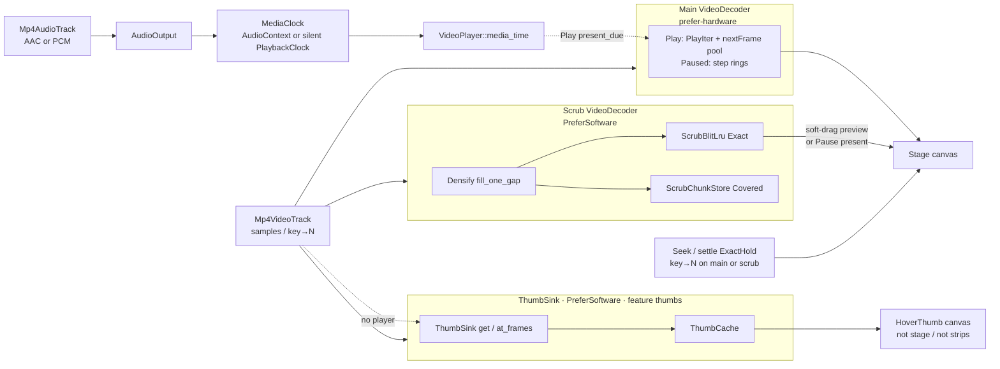
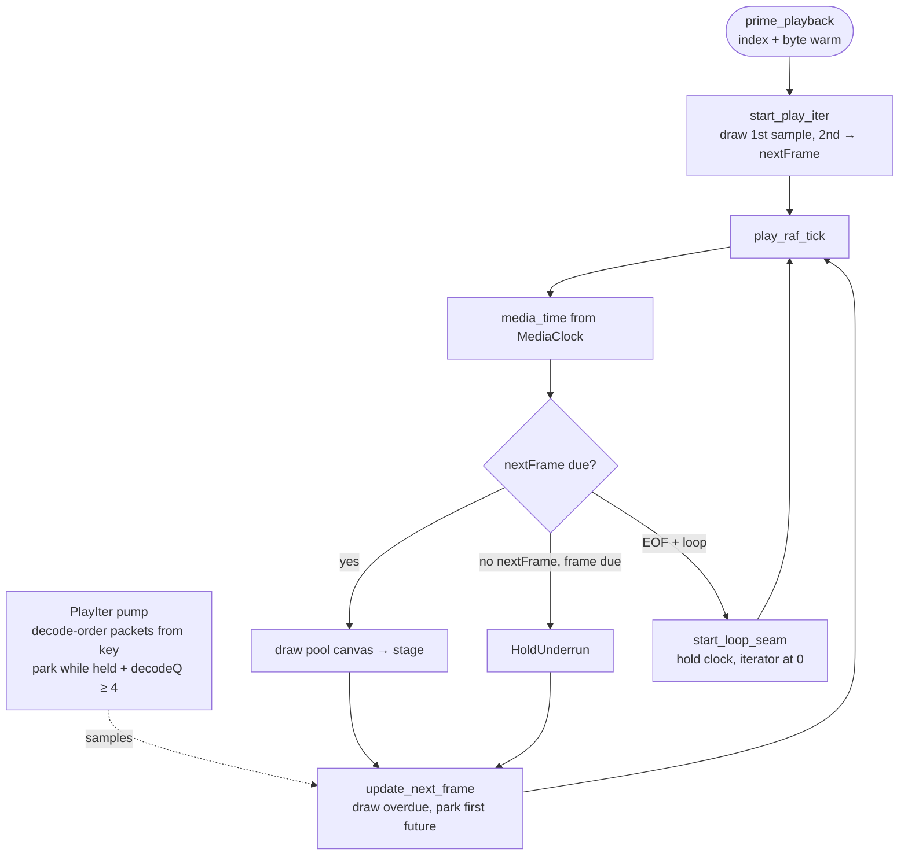
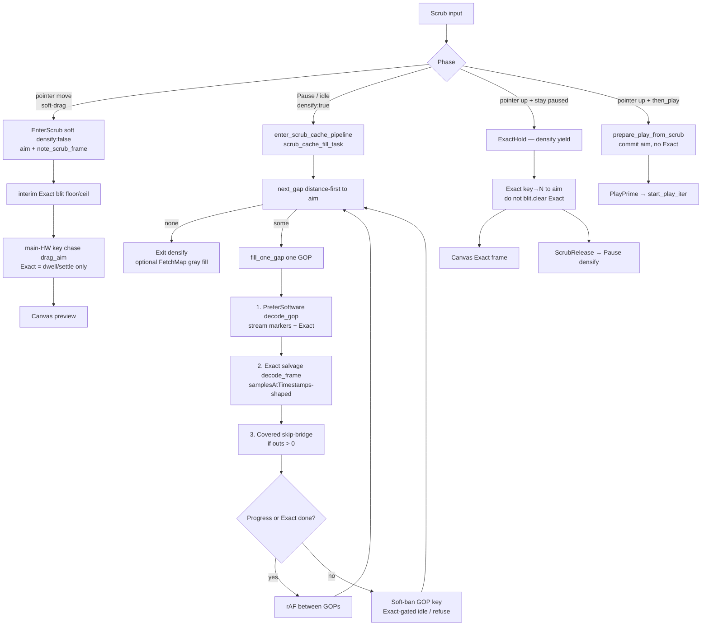
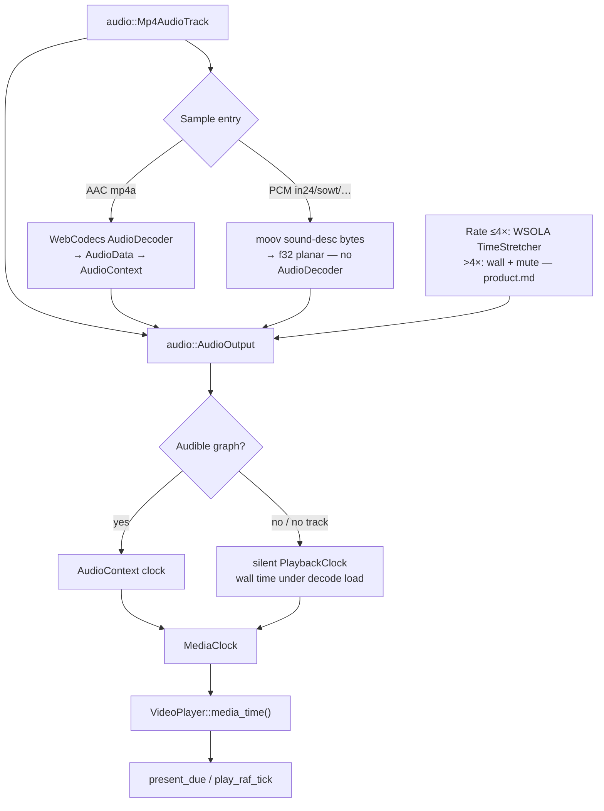

# Architecture

> Stable stack and code-structure context. Read at start of every session.
> Change only after a technical decision proves itself across sessions.
> Backlog / Still open → `.ai/state.md` only (`AGENTS.md` doc write gate).
> Shared vocabulary (settle, densify, Exact, Covered, …) → `.ai/glossary.md`.

---

## Stack

| Piece | Choice |
| ----- | ------ |
| Language | Rust |
| Framework | Leptos CSR — `mount_to_body` SPA |
| Demo host | Trunk (`demo-player/`) — one CSR app for local + Pages; no Axum |
| Local media URL | Same-origin `/media/*` from `demo-player/public/media/` (`npm run media:fetch` ← testvideo v0.3.0) |
| Pages demo | `trunk build --release --public-url /fpmedia-web/` → `demo-player/dist` (`state.md`) |
| Demo UI | `demo-player` — **all** player chrome (controls, scrubber composition, thumb labels). Product boundary: `product.md` § Surfaces |
| Media element | `fpmedia-web-components` — `<Video>` / `VideoRef` + `TimelineRef` + `<VideoPlaylist>` + headless `<Scrubber>` / `<TimelineMeta>` / `<HoverThumb>` (`product.md` § Element-layer helpers). Modules: `video`, `timeline`, `video_playlist`, `scrubber`, `timeline_meta`, `hover_thumb`, `strip`, `helpers` |
| Media engine | `fpmedia-web` crate — demux + frame index + `VideoPlayer`; wasm WebCodecs in `decode/`; **`audio/`** for demux/stretch/output |
| Browser helpers (UI) | **`leptos-use`** for observers / DOM events / rAF — prefer over raw `web-sys` in `components/` / `demo-player/` |
| Styling | Tailwind in `demo-player/style/input.css` (Trunk `rel="tailwind-css"`, auto-download CLI). Prefer **canonical** utilities (`min-w-11`, `min-h-5`, …) over arbitrary `[…]` values when a scale class exists; reuse combos via `@utility` + `@apply`. Arbitrary OK only when no scale fit (e.g. `text-[11px]`, `max-w-[min(18rem,42vw)]`, complex shadows). |

### Leptos UI rules

Long-lived host UI lives **outside** matched routes when routes are added. **Resources:** `resource.get()` in view closures is fine in CSR; show loading UI while `None`. Failure modes: `skills/leptos.md`.

**Browser APIs in `components/` / `demo-player/`:** prefer [`leptos-use`](https://leptos-use.rs/) over hand-rolled `web-sys` + `Closure`. Keep raw `web-sys` for media surfaces (`HtmlCanvasElement`, `Performance`, File) and anything the engine crate owns (WebCodecs / `AudioContext`). Media clock is owned by `fpmedia-web` — hosts call `VideoPlayer::media_time()`, they do not open `AudioContext` themselves.

---

## Layout

```
fpmedia-web/               ← GitHub repo
├── engine/                ← package `fpmedia-web`
├── components/            ← package `fpmedia-web-components`
├── timecode/              ← package `fpmedia-timecode`
├── demo-player/           ← Trunk CSR demo (UI + style + public fixtures)
├── e2e/                   ← Playwright Chromium smoke (WebCodecs)
└── .ai/                   ← product / architecture / state / skills
```

Engine module map (file triage): `.ai/skills/media.md`.

### Layer rules

| Layer | Can import from |
| ----- | --------------- |
| `timecode/` (`fpmedia-timecode`) | nothing else in the workspace (leaf math) |
| `engine/` (`fpmedia-web`) | `fpmedia-timecode`; nothing in `components` / `demo-player` / Leptos framework |
| `components/` (`fpmedia-web-components`) | `fpmedia-web` (with `webcodecs`), Leptos, `leptos-use` |
| `demo-player/` | `fpmedia-web-components`, Leptos — not `fpmedia-web` directly |

---

## Architectural decisions

| Decision | Why |
| -------- | --- |
| Rust + Leptos CSR (Trunk demo) | One language for engine + UI; demo has no Axum/SSR |
| CSR SPA | Simple mental model; static shell + WASM mount |
| Isolated `fpmedia-web` crate | Engine reusable without UI; no Leptos in demux/decode |
| Isolated `fpmedia-web-components` crate | HTML `<video>` analog + headless track helpers; **no** player chrome (`product.md` Elements first) |
| WebCodecs + canvas | Frame-precise decode; stage mirrors sized `<video>` (contain + metadata) |
| `leptos-use` for browser helpers | Observers/events/rAF in UI crates; media crate stays free of Leptos |
| Adapt mediabunny ideas in Rust | Required reference; port patterns, never depend on the TS package (`AGENTS.md`). MB = sinks + examples; our `<Scrubber>` / `<TimelineMeta>` / `<HoverThumb>` are Leptos adapters over `VideoPlayer`, not MB UI ports |
| Progressive open via `MediaSource` | Ranged reads; parse `moov` (+ `moof` for single-file fMP4); keep `re_mp4` for sample tables. Do **not** `array_buffer()` the whole file into WASM. |
| Dual decoder + scrub / play caches | Dual `VideoDecoder` so background fill does not steal playback. Design: [Play / scrub residency](#play--scrub-residency). Traps: `skills/media.md`. |
| ThumbSink + optional hover (`thumbs`) | **Shipped:** `ThumbSink` = mediabunny-shaped `CanvasSink` product (`get` / `at_frames`, `FrameId`, sized `ImageBitmap` + `ThumbCache`). Usable without `VideoPlayer`. Feature default on; runtime `ThumbPolicy`; player leases one PreferSoftware decoder. Host hover: `<HoverThumb>` (`product.md`). Not a TS API clone — see [Decode flows](#decode-flows) |
| Audio in engine, not `VideoRef` | Demux + `AudioDecoder` + `AudioContext` + WSOLA in `fpmedia_web::audio`. `VideoPlayer` orchestrates A+V; `VideoRef` = volume/mute API. `audio/` has no canvas dependency. |
| Component API like HTML media | Elements: open/play/seek/rate/volume + `<Scrubber>` / `<TimelineMeta>` / `<HoverThumb>`. Strip math: `fpmedia_web_components::strip` (engine keeps only `coalesce_frame_runs`). Demo owns chrome + JKL/Space/arrows. Host scrub UI must not require reading `PipelineStats` |
| Domain schedulers, not one global async OS | Byte IO → **shipped** `ReadOrchestrator` + open-ended `UrlSource` workers. Host ops → `OpQueue`. Decode → dual decoder + Play/Scrub modes. Shared **`WorkloadMode`** knobs — **not** one priority queue for every `spawn_local`. |
| Prefer explicit state machines over flag soup | Enum + `reduce` / coalesce table per domain. See [State machines over flags](#state-machines-over-flags). Host: `fpmedia_web::transport` + `ScrubRelease { then_play }` + `VideoRef::scrub_pointer_*`. |
| Playlist = 2× `<Video>` composition (agreed, UI not shipped) | Review playlist without N decoders / NLE in engine. See [Playlist composition](#playlist-composition-agreed-ui-not-shipped). UX: `product.md`. Steps: `state.md`. |

---

## Playlist composition (agreed, UI not shipped)

**no equivalent** (playlist / dual-slot composition local). Per-clip open/play/EOF still mediabunny-shaped inside each `VideoPlayer`.

| Piece | Rule |
| ----- | ---- |
| Slots | Exactly **2** `<Video>`: **live** (play / aim) + **idle** (preload neighbor: open + byte/index warm; densify/thumbs off until live or aim) |
| Timeline axis | Global scrub = **duration** (sum of clip durations). Map `t → (clip_index, local FrameId)` via each clip’s fps/duration. Mixed fps = native rate per clip (no conform) |
| Shared scrub handle | **Shipped:** `TimelineRef` — scrub/hover for `<Scrubber>` / `<HoverThumb>` (`VideoRef` / `VideoPlaylistRef` `as_timeline`). `VideoPlayer` / `<Video>` stay single-clip |
| Playlist model + host | **Shipped:** `video_playlist` — model/`[i]`; `<VideoPlaylist>` / `VideoPlaylistRef` (2 slots, probe, play seam, `TimelineRef` ms). Cross-clip scrub rebind — `state.md` |
| Facade | Host sees one logical media (play/pause/seek/scrub/rate). `VideoPlayer` unchanged (single-clip) |
| Seam | Clip EOF → swap live/idle, play next from local 0; last clip → `ended` / loop. Short hitch OK; gapless audio later |
| Shared scrub / thumbs | One scrub gesture over playlist model; thumbs route to the slot that owns the source (shared app-wide `ThumbSink` later) |
| Compare (later) | Same 2-slot pool, both visible — not the playlist playhead model |

Implementation slices: `state.md` § Playlist.

---

## State machines over flags

Event-loop races (pointer → microtask → `OpQueue` → rAF) are **not** fixed by more `RwSignal<bool>` or TLS. Rust `Send`/`Sync` also does not order JS turns.

**Prefer:** one state enum per domain + sync `reduce(Event) -> (State, Cmds)`; illegal combos unrepresentable; coalesce in the scheduler; call sites only dispatch / run cmds.

**Avoid:** sticky latches in demo + component + TLS; Effects that clear intent “when playing flips”; half-ported machines.

| Domain | Machine |
| ------ | ------- |
| Host transport | `fpmedia_web::transport` + `ScrubRelease { then_play }` + `VideoRef::scrub_pointer_*` |
| OpQueue | `fpmedia_web::HostOp` / `apply_enqueue` (in place); epochs preserved on survivors |
| Engine mode | `fpmedia_web::engine_mode` (`Play` / `Scrub` / `ExactHold` + `AudioResume`) |
| Decoder slot | `fpmedia_web::decoder_slot` (`Idle` / `CheckedOut` + `reset_pending`) |
| WorkloadMode | `fpmedia_web::workload` (Play > Seek > Open > Bg) |
| Byte IO | `ReadOrchestrator` + `UrlSource` / `BlobSource` stream workers |
| Open / backfill | `fpmedia_web::open_phase` (`OpenPhase::label`) |
| Media clock | `fpmedia_web::clock_state` |
| Play session | `fpmedia_web::PlayPhase` (`Idle` / `Live` / `LoopSeam`) |
| rAF restart | `fpmedia_web::session` (`restarting`) |

**Success bar:** a new race is fixed by a transition or coalesce row, not another flag. Failure modes: skills.

---

## Progressive open (MediaSource)

**Shipped (wasm demo):** `MediaSource` + `BlobSource` / `UrlSource` on `ReadOrchestrator` (Url: open-ended Range workers, `Network` prefetch; Blob: 4 `blob.stream()` workers, `FileSystem` ±64 KiB prefetch, 8 MiB — `arrayBuffer()` per read only on WebKit; `mediabunny: src/source.ts`) / `MemorySource` + `CachedSource` (512 MiB LRU, 8 MiB quantum; orch cache mediabunny-default 64 MiB); gray strip via `FetchMap` (**accumulate** ever-fetched ranges — not a live LRU mirror). Top-level `ftyp`+`moov` (+ full `moof` for single-file fMP4) → `re_mp4`. Element `open_blob` / `open_url` (CORS-ok or same-origin URL — **no** auto `/proxy` in `fpmedia-web-components`). Async AVC sync verify after moov. One progressive entry `open_mp4(source, options, progress)` → `OpenedMp4` (always `CachedSource`; `mediabunny: src/input.ts Input`); sync `open_mp4_bytes` for fixtures/tests.

**Demo URL open:** one UI everywhere. Progressive local URL = static `/media/*` under `demo-player/public/media/` (fetch script; gitignored). Demo may rewrite known testvideo Release download URLs to `/media/…`. No CORS/media proxy (Trunk→GitHub redirect broken). Pages: Browse (Blob) or CORS-ok URLs. Element crate never rewrites (`components/README.md`).

**Out of scope:** stream-only / live fMP4; DASH/HLS; MSE remux; production open proxy. **Open work:** `.ai/state.md`.

**Success bar:** 1080p progressive open to first paint without allocating the full media size in WASM.

### Test media

| Kind | Where |
| ---- | ----- |
| Tiny unit/smoke MP4s | `fixture_*.mp4` under `engine/tests/fixtures/` + `demo-player/public/` (gitignore allows that prefix only) |
| FullHD A/V sync plates | **[testvideo](https://github.com/alexantoshuk/testvideo)** Releases — catalog `e2e/helpers/testvideo.ts` |

Do **not** wire probes to Downloads / third-party hosts. In skills prefer meta (fps, GOP, resolution, bf); asset names = testvideo stems.

---

## Play / scrub residency

Dual `VideoDecoder`: main = play/seek; scrub = densify (never steals main HW). UX strip colors: `product.md`. Vocabulary: `glossary.md`.

| Store | Role |
| ----- | ---- |
| `PlayIter` + 2-canvas pool | Play only: ≤ 4 decoded + in-flight samples, one `nextFrame` canvas |
| Presentation queue | Paused Next hits (`PlayPolicy::presentation_cap`); empty while Playing |
| Step behind ring | Prev hits; **Play cap 0**; Pause/scrub uses behind=8 |
| `ScrubChunkStore` | Covered gap markers — **presence only, uncapped** for the open clip |
| `ScrubBlitLru` | Live Exact bitmaps; cap from `scrub_blit_frame_budget` |
| `ThumbSink` / `ThumbCache` | Thumb product + hover client (3rd decoder); feature `thumbs` |

Runtime gates (host intent, re-applied on every open): `ThumbPolicy` (thumb sink) and **`ScrubCachePolicy`** — `Off` closes the scrub decoder, clears Covered + Exact, refuses densify / gray fill / scrub ingest; seek/step/Play stay on main. Demo: Scrubber toggle → `ScrubCachePolicy`.

**Modes (summary):** Play → densify off (epoch cancel). Hard Pause / settle / step → densify on when `ScrubPolicy::densify`. Soft-drag → densify off under finger + interim Exact blit + main-HW nearest-key chase (Exact = dwell/settle; PreferSoftware densify under finger saturates mobile). One entry: `VideoPlayer::enter_scrub_cache_pipeline`. In-flight GOP densify is not cancelled on aim move (drag aborts fill for the gesture). Covered keeps densify/Exact trail for the clip (no marker LRU); Exact eviction = farthest from aim on blit `AimWindow` only. Pause densify fills Exact first; Covered-only densify is hard-bounded to aim±`COVERED_EDGE_MARGIN_FRAMES` (300; store stays uncapped for the trail; pinholes must not walk EOF). Not Exact cap / not GOP soft-drag margins. `mediabunny:` CanvasSink pool idea — no still-encode store.

### Decode flows

Shipped control flow (not backlog). Terms: `glossary.md`. Phase × mode table: [Scrub phases](#scrub-phases) below. Failure modes: `skills/media.md`.

**Overview — who decodes what**



Play paints `PlayIter` samples from the **main** decoder (checked out for the whole session), paced by **`media_time()`** from the engine media clock (audio-driven when a track exists — including muted/silent graphs; see [Audio + media clock](#audio--media-clock)). Soft-drag: interim Exact blit + coalesced Exact on **main** (densify aborted). Settle / seek Exact key→N yields densify (`ExactHold`) so PreferSoftware densify does not dual-HW race the main path. Pause idle runs densify on the scrub decoder into Exact + Covered. Hosts never open `AudioContext` as their own clock.

**ThumbSink** (optional `thumbs`): mediabunny `CanvasSink`-shaped product — `ThumbSink::new(track, opts)` → `get` / `at_frames` / sync peek; sized `ImageBitmap` + `ThumbCache` residency (not MB ring `poolSize`; default caps 256/256). **Does not require** `VideoPlayer`. Hover is a client: player leases one PreferSoftware decoder, Exact→thumb bridge, workload gates; host `<HoverThumb>` paints its **own** canvas. UX: Play and Pause only — **not** while scrubbing; must not drive densify or Fetch/Covered/Exact strips (`product.md`). Never reuse the densify scrub decoder for thumbs. Play: cache + Exact bridge only (no generation). Pause progressive: duration-based coarse sync grid (~3 s, clamp 8–32, ≤`max_thumbs/4`) then farthest-key densify; each thumb stores progressive **rank** (0=coarse … Exact non-key=`u16::MAX`); at cap evict highest rank first so the timeline grid stays even. Hover uses the same rank helper. Progressive stops when no candidate can admit without dropping a coarser rank. Host `(hover: none)` → `ThumbPolicy::Off`. **no equivalent** (filmstrip local); decode `mediabunny: src/media-sink.ts CanvasSink` / `canvasesAtTimestamps`. Traps: `skills/media.md`.

**Play — mediabunny iterator port** (`mediabunny: src/media-sink.ts mediaSamplesInRange`, `examples/media-player` `startVideoIterator` / `updateNextFrame` / `render`)



`PlayPhase` (`Idle` / `Live` / `LoopSeam`) is the session machine; seek / scrub / pause end it (`clear_play_session` → `PlayIter::finish` resets and returns the decoder). Seek / step / Exact stay on `decode_frame` + warm pump (`samplesAtTimestamps`-shaped); Play never reads the presentation queue.

While Playing: densify is off (epoch cancel); Exact trail uses farthest-evict trim only — never a full Exact wipe. Continuous Play prioritizes cadence and A/V sync over painting every presentation frame (`product.md` Exact vs Play). Shuttle may drop overdue frames. Prefer mediabunny present + clock patterns; silent clock uses wall time when there is no audible audio graph.

**Scrub — soft-drag / Pause densify / settle**

Scrub gesture / densify / Exact blit are **local** — mediabunny has no scrub pipeline (`AGENTS.md` § Scrub is local). Cite MB only for demux/decode/sink primitives inside a scrub change.



Soft-drag must not run PreferSoftware densify under the finger; picture updates via main-HW **key** chase on `drag_aim` (Exact = dwell/settle only — traps: `skills/media.md`). Soft-drag **and** hover-thumb interim paint pick neighbors with **floor when moving forward / ceil when backward** (`scrub_preview_neighbor` + `scrub_dir` / `hover_dir`) so Exact/aim refine does not jump opposite the gesture. Settle must not wipe Exact blit (soft-drag trail). Densify soft-ban stops infinite re-decode; residual pin-holes on constrained machines are accepted strip cosmetics (`product.md`). Scrub-while-play release skips Exact.

### Scrub phases

Host gesture × engine (FSM homes: `fpmedia_web::transport`, `fpmedia_web::engine_mode`). Exactness = settle / seek / step / Pause canvas — not soft-drag (`product.md` Exact vs Play). Hover thumb: Play + Pause only, not while `Scrubbing` (`product.md`).

| Phase | Host `TransportState` | `EngineMode` | Densify | Picture | Entry |
| ----- | --------------------- | ------------ | ------- | ------- | ----- |
| Play | `Playing` | `Play` | off | `PlayIter` `nextFrame` | play / rAF |
| Soft-drag | `Scrubbing` | `Scrub` (+ soft audio hold) | off under finger | interim Exact blit + main-HW **key** chase (Exact = dwell/settle) | `VideoRef::scrub_pointer_down/move` → `note_scrub_frame` / `scrub_to(settle=false)` |
| Pause / idle scrub | `Ready` (paused) | `Scrub` | on if `ScrubPolicy::densify` | densify → blit + markers | `enter_scrub_cache_pipeline` |
| Settle | `Settling` | `ExactHold` | deferred (yield) | Exact key→N | paused `ScrubRelease` only — **do not** full-clear Exact blit (see `skills/media.md` soft-drag frozen) |
| Resume | `PlayPriming` → `Playing` | → `Play` | off | PlayIter draws aim (no Exact / no audio prewarm) | `ScrubRelease { then_play }` → `prepare_play_from_scrub` → PlayPrime |

Traps: `skills/media.md`. Host playhead / `scrub_pointer_*`: `skills/leptos.md`.

### Predictive densify

Local invention (no mediabunny CanvasSink densify equivalent). Unit of work = one GOP; `next_gap` is **distance-first** to aim (far/edge loses to budget eviction); `scrub_dir` (±1) only breaks equal-distance ties. Settle/play clears dir to neutral.

**GOP fill (`fill_one_gap`):** (1) PreferSoftware `decode_gop` range decode → stream markers + Exact blit; (2) Exact salvage — any GOP id still missing blit → scrub `decode_frame` key→N (`mediabunny: samplesAtTimestamps` vs `samples()` range); (3) Covered skip-bridge for marker ids still absent (`outs > 0` only). Soft-ban a GOP key only when Exact cannot improve (blit complete / cap refuse / idle retries) — never because Covered alone looks solid. Traps: `skills/media.md`.

### Policies

**`GopProfile`** (scrub only, from frame index):

| Profile | When | Densify (Pause) | Drag |
| ------- | ---- | ---------------- | ---- |
| `AllIntra` | every sample sync | off | soft + main-HW key (= frame; densify off) |
| `ShortFixed { len }` | max GOP ≤ 30 | on (PreferSoftware) | soft + main-HW key chase (Exact on dwell/settle) |
| `Long { median, max }` | max GOP > 30 | on (PreferSoftware) | soft + main-HW key chase (Exact on dwell/settle) |

**`PlayPolicy`** (from coded height) — paused step ring cap + seek/step warm pump only. **Play reads none of it:** mediabunny `MAX_QUEUE_SIZE = 4` + 2-canvas pool for every resolution (add Play profiles only if a clip proves they are needed).

| Class | Cap / warm |
| ----- | ---------- |
| `Hd` (&lt; 2160) | 4 / 4 |
| `Uhd` (≥ 2160) | 10 / 8 |

**Main play** always probes `prefer-hardware` when supported (`WebCodecsDecoder::create` `allow_hw=true`) — Hd and Uhd. **Scrub/thumb** always `PlayPolicy::hd()` + explicit `prefer-software` (sole HW session on main; `no-preference` can still grab HW). `optimizeForLatency` = false for VOD.

**`ScrubPolicy`** (from `GopProfile`): `densify` / `blit_mib` / edge margins (`scrub_cache_mib` = legacy meter only; Covered uncapped). Soft-drag: interim blit + main-HW nearest-key chase (Exact = dwell/settle — Exact-under-finger caught up after stop). Pause densify PreferSoftware when `densify` on; All-Intra `densify` off (1-frame GOP fill wastes CPU).

**`SettlePolicy`** (clip-invariant defaults): densify yield `250+250 ms`, `gop_sample_lead` 8…24, index warm leads (`play_index_lead` also feeds the Play iterator). Soft-cold / poison are named recovery helpers, not policy fields. Do not retune Settle when changing Play Uhd or Scrub MiB.

Traps (flush/idle, cold settle, dual-HW): `skills/media.md`.

### Audio + media clock

Terms: `glossary.md`. Overview link: [Decode flows](#decode-flows).



PCM sample-entry bodies are not in `re_mp4`’s `Unknown` payload — walk raw `moov` (same pattern as `tmcd`). Codec map + decode: mediabunny `isobmff-demuxer` FourCC map + `media-sink.ts` `PcmAudioDecoderWrapper`. Hosts never open `AudioContext` as a disposable clock. Soft-hold on scrub/Pause keeps the graph; underrun holds audio without tearing the decoder down. mediabunny has no rate API equivalent — WSOLA is local. UX rates: `product.md`.

---

## Code rules

- Errors: `thiserror`. A panic kills the whole wasm instance (player + `AudioContext`) until reload, so:
  - No panics on paths reachable from browser events, the environment (`window` / `document`) or external data (file bytes, network) — return `Err` / `let … else`.
  - `.unwrap()` is forbidden outside tests (enforced: workspace Clippy `unwrap_used = "deny"`).
  - `.expect("<invariant>")` only for an invariant proven in the same function, when a `let … else` / entry-API rewrite reads worse.
- WebCodecs needs `web_sys_unstable_apis` (`.cargo/config.toml`).
- **WebCodecs / media resources:** RAII owners + borrow helpers (`OwnedVideoFrame` / `AsVideoFrame`); **move into caches**, **borrow to draw**. Gotchas: `skills/media.md`.
- **Mediabunny reference:** `AGENTS.md` Mediabunny-first — do not restate here.
